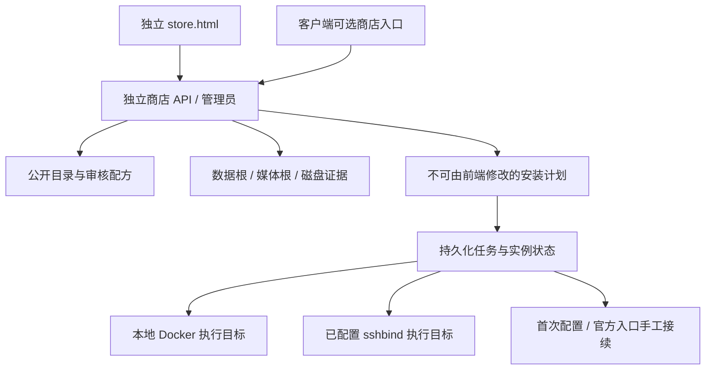

# 极空间第三方应用商店设计稿

日期：2026-10-10（Asia/Shanghai）
状态：独立 Web 商店、Go/SQLite 服务、配方与安装向导已实现并进行本地验收；真实服务与示范应用部署仍须独立记录，不宣称完整交付。
已确认边界：商店可独立部署、独立登录，桌面客户端内只提供可选入口；NAS 客户端直接调用官方接口，Go 不提供自建 NAS REST。官方桌面与远程接续仍是待验收目标。

## 1. 产品目标

让用户在极空间上完成“找到应用 → 填写初始化设置 → 安装 → 打开 → 日常维护”，不必手工拼接 Compose、查宿主机路径或录入端口。

每个上架应用提供分类、用途、真实图标、来源、支持的设备架构、版本、存储需求和安装配方。安装成功后，目标是自动创建官方远程访问条目并显示在极空间桌面；这项能力需要先通过实机验证，不能以容器运行成功代替。

本项目遵守用户禁止删除数据的要求。商店和部署工具不提供删除数据操作，既有容器与目录不自动接管。涉及向已有用户目录授予读写权限的配方，必须先讨论。

## 2. 已核实的环境与参考边界

下表保留 2026-10-10 首轮通过 sshbind 对 usable=true 目标进行的只读环境快照，不代表当前部署完成状态：

| 项目 | 结果 | 对设计的影响 |
| --- | --- | --- |
| 初始工作区 | 当时为空目录，无 Git 仓库；现已有本地源码与 Git 分支 | 当前实现为独立产品，不直接继承旧客户端 |
| NAS 架构 | x86_64 | 第一版实机交付针对 linux/amd64 |
| 系统 | ZOS V1.0.0450046 | 私有接口适配须记录系统版本 |
| Docker | 27.3.1，账号属于 docker 组 | 已验证版本查询、容器列表与选定容器 inspect；未测试创建 |
| Compose | v2.29.7 | 可作为声明式部署基础 |
| sudo | 当前账号没有免密 sudo | 不以宿主机特权服务为第一版前提 |
| 官方 Web | 5055 端口，返回极空间页面 | 已读取静态前端代码，未获取登录态或调用写接口 |

参考 [fnos-apps](https://github.com/conversun/fnos-apps) 提供应用目录与打包，实际商店位于 [fnos-store](https://github.com/conversun/fnos-store)。其 FPK、appcenter-cli、fnOS 平台 RPC 和桌面声明不能直接用于极空间。应用列表也不等于全部应用已经适配极空间。

极空间官方介绍了 [Docker、Compose 和远程使用能力](https://zspace.cn/t6/)，但产品介绍不能代替第三方包规范。官方远程访问面向 NAS 同局域网中的网页服务，不能推导任意 TCP/UDP 服务可通过它转发；见 [官方软件说明](https://www.zspace.cn/software/software_h5.html)。

## 3. 已确认路线与范围

| 路线 | 交付内容 | 主要取舍 |
| --- | --- | --- |
| A：官方集成优先 + Web 桌面兜底，已选择 | 独立商店、向导、容器管理、官方入口适配、自己的应用桌面 | 最接近目标；官方私有接口变化时，商店本身仍可用 |
| B：完全依赖官方桌面 | 以官方桌面和官方远程访问作为唯一完成标准 | 原生体验集中，但交付依赖接口认证、注册能力和厂商限制 |
| C：独立客户端优先 | 自建 Web/PWA 界面，后续可封装 Mac/Windows 客户端 | UI 自主性最高；重做客户端本身不会自动获得官方远程隧道 |

用户已于 2026-10-10 确认：“官方集成优先，另做漂亮的 Web 应用桌面作为兜底（推荐）”。路线 A 作为后续设计和实施计划的确定前提，不再重复询问相同范围问题。

官方集成的优先顺序：验证可正常授权的按条目注册 → 验证可保留既有配置的官方页面接续 → 提供独立 Web 桌面。每一项分别记录结果；接受 Web 兜底不代表放弃验证官方路径。

独立 Web 桌面通过配置好的局域网地址或用户选择的远程通道访问。它自身不能凭空提供内网穿透，不能把局域网 URL 标成已支持外网。

此稿负责独立商店。完整 NAS 客户端的相册、影视、音乐和系统设置见 [客户端设计](2026-10-10-zspace-client-design.md)；二者共用部分 React 界面，但认证、服务地址和执行目标独立。用户无需安装桌面客户端或登录 NAS 账号即可使用商店网站。

## 4. 架构

当前商店使用 Go、SQLite 和 React/TypeScript。构建包含 `store.html` 与客户端 `index.html` 两个入口；Go `/` 默认打开独立商店，只注册商店 API 与健康检查，`/api/nas/*` 返回 404。旧 `server/internal/nas` 不作为商店或客户端运行依赖。



- **目录与配方**：公开浏览类别、版本和用途；区分可安装与待适配。前端不能提交任意镜像或 shell 替代审核配方。
- **存储登记**：检测真实挂载来源、介质、容量、数据池与系统盘状态。仅登记存在且安全的目录，不根据拼错路径自动创建目录。
- **计划与任务**：服务端固定 `planId`，前端确认后提交 `planId` 与幂等 `requestId`。重试不重复创建实例；计划、执行与恢复时复验归属、路径和卷身份。
- **容器管理**：只控制数据库记录与商店标签匹配的实例，停止保留数据。创建、健康、初始化和入口状态分别记录。
- **官方接续**：当前以 `handoff` 明确表示仍需完成官方入口配置，不将容器健康伪装为官方集成成功。后续自动注册须单独验证。

执行目标有 disabled、local 和 sshbind 三种模式：disabled 可浏览但不执行安装；local 在商店所在设备调用 Docker；sshbind 在商店所在管理机使用已经配置且可用的别名执行受限命令。使用 sshbind 模式时，该执行能力确实属于商店运行依赖，不能宣称部署后完全不需要；若商店部署在 NAS 本机则可使用 local。NAS 客户端的正常登录与读取均不依赖该服务。

商店地址可在客户端独立设置，只保存非敏感地址；切换时先注销旧商店会话。未配置外部服务时，Tauri 可在打开商店时按需启动本机商店 sidecar。`gateway.json` 是历史配置名，仅包含商店引擎、SSH 别名与存储根；它不是 NAS 登录网关。商店安装目标不能由当前 NAS 登录地址自动推导。

服务公开访问配置区分 `--listen`、`--publish-host`、`--access-host` 与 `--public-origin`：分别控制商店监听、应用端口绑定、生成的应用访问主机和明确允许的浏览器来源。不能把容器内部地址或管理端口当作可公开访问地址。部署脚本与配置详见 [独立商店部署说明](../../deployment/standalone-store.md)。

商店管理员使用独立账号和密码，没有默认凭据；首次设置仅允许服务本机发起，之后关闭重复设置入口。目录/status 可公开读取，存储、计划、安装、任务与实例启停由服务端校验商店会话，logout 撤销服务端授权。第三方应用自身的账号和数据权限与商店权限另行处理，不以入口可见性代替应用内授权。

商店引导部署必须在选定的新目录内完成，先本机/SSH 端口转发初始化管理员，再按明确的监听与来源配置开放访问；官方远程注册不作为商店启动前提。引导阶段已创建批准的新 `space-desktop` 目录并设置该目录 `0700`；独立商店随后已在 NAS 的 18435 端口启动，用户正在通过本机连接或 SSH 转发设置管理员。后续发布、日志与元数据仍限制在该批准范围，不能把服务首屏当作应用安装完成。

## 5. 官方桌面与远程访问适配

当前版本官方静态 JS 存在以下线索，全部属于“已发现，尚未完成认证与行为验证”：

| 机制 | 已发现的名称或字段 | 尚需验证 |
| --- | --- | --- |
| 官方 Docker 应用流程 | /zdocker/AppStore/v1/pkg/preinstall、install、list | 是否允许自定义第三方配方或仅允许官方目录项目 |
| Docker 快捷方式 | /shortcut/adddockershortcut、dockershortcuts | 请求字段、权限、桌面刷新与多端行为 |
| 远程访问列表 | KV key 为 remoteAccess；包含 icon、color、remarks、url、https、proxy、desktopVisible | 用户作用域、图标格式、保存兼容性 |
| 远程访问注册 | /zrps/api/remoteaccess/add | 正常授权、代理创建结果与外网连通性 |
| 官方配置接续 | configRemoteUrl、dockerId、ports 路由参数 | 能否在安装后打开并预填官方配置界面 |

官方接口存在不等于第三方应用已获支持。实现时优先寻找按条目新增/更新接口；如果只能写整组 KV，必须保留全部未知字段和已有条目。

整组 KV 写入须核验版本或条件更新机制。仅在商店内加锁不能阻止官方客户端并发修改；如果不存在可保证不覆盖他人修改的协议，自动写整组列表不作为合格方案，改为打开预填官方配置页并标注需要完成最后一步。这一限制要在验证结果中向用户明确说明。

注册按“NAS + 授权用户 + 应用实例”识别，幂等新增，不能使用名称相同作为唯一去重条件。不覆盖其他用户的桌面，不把管理端口、数据库端口作为公开网页入口。

官方入口完成标准：注册记录可读回、桌面图标实际可见，并且在外部网络中通过官方客户端能打开应用。HTTP/HTTPS、Cookie、重定向、WebSocket、SSE 和上传按应用实际使用场景验收。本地端口返回 200 不等于官方远程访问可用。

适配失败时保留应用与数据，状态显示“应用已启动，官方入口待配置”。可重试注册，或进入官方配置页；采用路线 A 时还能通过独立应用桌面使用已配置的本地/远程地址。

## 6. 安装和初始化体验

当前向导的四步是：

1. **应用详情**：展示配方、版本、镜像、可安装状态和权限范围；未登录管理员不能生成计划。
2. **存储目录**：选择或登记应用数据根，填写新实例目录；Navidrome 必须另外选择已登记的媒体根与内部音乐库路径。
3. **端口与检查**：选择访问端口，服务端核验环境、路径、Docker 镜像位置与端口，再生成计划；此步骤不执行安装。
4. **确认安装**：读回服务端计划的镜像、数据根、媒体根、卷身份、挂载权限与访问地址；明确勾选确认后才提交安装。

`rootId` 与 `mediaRootId` 不能混为一项。实例数据写入数据根下全新目录；媒体可位于另一块盘，`mediaPath` 只能等于选定媒体根或其子目录。媒体树与可写实例目录不得互相包含，符号链接、真实挂载和身份均由服务端核验。

目录权限按实际能力返回：安全可写数据目录可有 `data` 与 `mediaReadOnly`；既有音乐库如果仅可读，应只有 `mediaReadOnly`、`mediaReadAllowed=true`，不因 `installAllowed=false` 被错误排除出只读媒体选择，也不能被用作实例数据根。

存储选择器区分 SSD、HDD、virtual 与 unknown，显示挂载路径、来源、容量和原因。虚拟 ku_fs 数据池不能假称 SSD；系统盘/eMMC 不能安装，Docker RootDir 的物理位置不明确时也阻止镜像拉取。目录登记不创建目标，不自动迁移 Docker，不修改既有目录权限。

安装任务按实际阶段记录镜像拉取、实例准备、容器启动和健康结果。只有真实进度才显示百分比，关闭窗口不停止任务。失败保留数据与诊断信息，恢复时复核已有归属以避免重复创建。

应用首次配置是独立阶段：支持初始化 API 才采用专用适配，否则通过新页面/系统浏览器打开应用，由用户完成其自身设置；不向第三方 iframe 注入原生权限桥。没有可靠读回机制，不自动标为“初始化完成”。官方远程/桌面入口默认接续待完成，不能被容器绿色状态覆盖。

## 7. 分类、配方与目录整理

主分类：影音与相册、下载与自动化、文件与备份、阅读与知识、网络与远程、系统与开发、AI 与智能、家庭与办公。一个应用有一个主分类，可有多个用途标签；依赖服务不单独冒充适合普通用户安装的应用。

每份配方必须说明：应用稳定 ID、上游来源、授权来源、分类、图标、支持架构、镜像 digest、配方版本、初始化字段、挂载权限、网页端口、健康检查、入口、迁移策略和实机验证结果。只有目录数据但没有可用配方的项目展示为待适配。

应用身份以稳定 app-id 为准；分类目录只用于源码组织。移动分类目录不能改变版本关联、已安装实例身份或运行数据路径。

当前可运行源码按下列职责组织；上游素材扩展、复杂初始化、升级与迁移仍属后续目标：

```text
apps/client/store.html             独立网站入口
apps/client/src/StandaloneStore.tsx 独立商店外壳
apps/client/src/modules/Store.tsx   目录、安装向导、实例和任务
apps/client/src/modules/StoragePicker.tsx   应用数据盘与目录登记
apps/client/src/modules/MediaRootPicker.tsx 只读媒体根选择
server/cmd/space-gateway/           独立商店服务，历史可执行文件名
server/internal/store/             管理员、SQLite、配方、任务、存储与执行
scripts/                           构建与独立部署工具
docs/deployment/                   部署配置与引导说明
docs/verification/                 版本化验收证据
```

运行数据放在用户选定的新目录下。极空间 `/tmp/zfsv3` 可能映射持久化数据池，不能当成可清理临时目录；路径须现场解析，不硬编码磁盘和账号。以下仅为逻辑组织示意，实际文件布局以服务实现和部署文档为准：

```text
<用户选定位置>/zspace-store/
  state/                       数据库、任务状态
  catalog/                     已验证目录缓存
  instances/<app-id>/<instance-id>/
    deployment/                Compose 与部署版本记录
    config/                    应用配置
    data/                      持久化数据
    logs/                      本实例诊断记录
  backups/<app-id>/<instance-id>/
```

分类调整只改变目录索引，不搬迁实例数据。已有音乐、影视、书籍和下载目录通过选择器引用，第一版默认只读；不自动整理、移动、重命名用户文件。

下载、双向同步和自动整理应用通常需要读写权限。第一批安装示范不包含对既有下载库的读写；这些应用在目录中可显示为待适配。后续可为它们设计全新的独立输出目录，但任何把已有目录改成读写的方案须先讨论，不能靠只读配方宣称下载/同步功能已经可用。

## 8. 不删除数据的实现约束

- 环境发现和存储探测优先只读。新 `space-desktop` 目录及其 `0700` 权限属于已批准引导范围；商店发布、日志与元数据也只追加到批准专用目录，既有资料不动。应用安装仍必须有独立执行与健康证据。
- 商店不提供清空数据、删除卷、删除目录或磁盘清理动作；禁止 prune、down -v、递归删除及自动清理失败安装目录。
- 所有应用持久化位置必须在安装计划中声明。不能将用户数据仅留在容器可写层，再通过重建容器间接丢失。
- 安装失败保留配置、数据和日志；重试须复用同一个实例身份，不覆盖或清空用户既有数据。商店自有部署配置按版本写入新目录并保留旧版本；应用已经保存的配置不能在重试时被默认值重置。
- 第一版的移出管理操作是停止并归档记录，保留容器、镜像、卷和目录；不沿用可能执行删除脚本的上游卸载动作。
- 既有容器仅发现和展示，导入管理须单独确认；不自动重建、批量改权限或接管。
- 检查更新和下载新镜像可以独立进行。执行升级需有应用专属迁移与备份策略；不承诺数据库降级可直接回滚，不自动覆盖新写入的数据。
- 对禁止删除的既有用户资料，只读挂载提供强约束。第三方应用获得某目录读写权限后，其自身功能仍可能删除目录中的文件；因此不能仅靠商店按钮保证所有第三方应用绝不删除数据。此类权限扩展须先讨论。

## 9. UI 设计

设计理解：供极空间用户日常使用的第三方应用工具，重点是清楚地找到、安装、打开和维护应用。按用户 2026-10-10 的视觉修订要求，采用更精致的 Mac 应用风格；当前视觉方向为 v2，路线 A 不变。

遵循用户指定的 [taste-skill 固定版本](https://github.com/Leonxlnx/taste-skill/blob/717446e07a78d4e6d7918b1fde1a263378eebac9/skills/taste-skill/SKILL.md)。该版本明确将密集产品 UI、多步向导列为范围外；此处采用其排版、色彩、层级、真实资产和完整状态原则，向导按产品表单设计，不套用营销页 Hero 和艺术滚动动效。

| 项目 | 设计规则 |
| --- | --- |
| 视觉参数 | DESIGN_VARIANCE 4、MOTION_INTENSITY 2、VISUAL_DENSITY 5 |
| 色彩 | 冷白 #FAFBFC、浅灰 #F0F2F5、石墨文字 #202328；单一系统蓝强调色 #0A64D8，深色采用对应全局主题。应用与品牌图标保留各自颜色 |
| 文字 | 中文系统无衬线，Mac 优先 PingFang；正文 13–14px，辅助文字 12–13px，标题 24–28px |
| 圆角 | 输入/按钮 8px，卡片 12px，对话框 16px |
| 图标 | 一个导航图标家族；应用图标采用真实项目资产，记录来源 |
| 动效 | 120–180ms，仅反馈和状态切换，支持减少动态效果 |
| 布局 | 约 215–224px 的分组侧栏、54–60px 紧凑工具栏，内容留白 28–32px；3–4 列应用网格，窄屏明确折叠 |

当前独立 Web 商店使用发现、已安装、安装任务与可折叠服务设置，复用客户端商店组件，手机使用单列和全页向导。早期侧栏方案属于商店内部的历史视觉建议，不是 NAS 客户端外层布局；完整客户端外层必须为系统桌面。

视觉结构参考 [Apple 侧栏](https://developer.apple.com/design/human-interface-guidelines/sidebars) 和 [工具栏](https://developer.apple.com/design/human-interface-guidelines/toolbars)，安装步骤结构参考 [飞牛官方安装说明](https://help.fnnas.com/articles/v1/media/media_install)。表中的像素、配色和布局参数属于本项目设计建议，不是官方规范的固定值。

侧栏和工具栏可采用轻微半透明材质，主内容和表单使用实底。Web 中实现的是轻量材质近似，不宣称使用 Apple 原生材质 API。概念图的 Mac 窗口外框用于展示场景，Web 页面不重复绘制系统红黄绿按钮；客户端外框跟随所在操作系统。

商店首页将精选推荐与紧凑应用卡片分开。精选区使用两张适度高度的推荐图，应用区以图标、名称、用途和小型安装按钮组织信息；不虚构评分、下载量或版本。不在首页常驻安装侧栏，保持浏览空间。

应用详情展示实际版本、用途、来源、截图、权限与主操作。我的应用展示运行状态、首次配置、更新与入口情况。应用桌面展示可打开的图标和分类，分别表达本地/远程可达性。

向导在桌面使用独立任务面板或对话框，手机使用全页步骤；桌面标签与字段可采用对齐的左右布局，窄屏标签移至字段上方。目录可搜索选择，端口冲突即时提示，字段有具体错误。加载、空目录、下载失败、镜像不可达、权限不足、初始化待完成和入口失败都有明确状态和下一步动作。

当前概念图：[v2 商店首页](../../design-assets/zspace-store-concept-v2-macos.png)、[v2.1 安装向导](../../design-assets/zspace-install-wizard-v2-1-macos.png)。向导与第 6 节的四阶段一致；官方能力尚未验证时默认选择局域网，原生远程与桌面选项保持待验证，Web 桌面入口可选择。图标与推荐图为生成式示意，实施时替换为核实来源的实际素材；设备信息和界面状态不代表运行数据。

生成方式为内置 imagegen，完整生成提示词及参考来源保存在 [v2 生成说明](../../design-assets/zspace-ui-v2-macos.prompt.md)。[v1 概念图](../../design-assets/zspace-store-concept-v1.png) 与 [v1 提示词](../../design-assets/zspace-store-concept-v1.prompt.md) 保留供比较。

## 10. 分期和验收

| 阶段 | 交付与完成条件 |
| --- | --- |
| 能力验证 | 在全新测试实例验证正常授权、初始化接续、自定义图标、官方桌面、官方远程访问；列明自动化受限的步骤 |
| 商店基础 | 分类搜索、真实配方、目录选择、端口检查、安装计划、任务恢复、我的应用和独立桌面 |
| 完整示范应用 | 建议先用 Uptime Kuma 验证新数据目录，再用 Navidrome 验证已有音乐库只读映射；此处为候选，未安装 |
| 应用扩展 | 加入其他经过初始化、权限和远程链路验证的应用；未验证项目显示待适配 |
| 客户端与更新 | PC 已选择 Tauri，独立 Web 商店可单独使用；备份、升级与恢复按应用另验 |

正式验收至少覆盖：初始化表单、实际容器创建、进程健康、首次配置、图标可见、外网官方客户端打开、多用户隔离、重复安装请求、服务重启后恢复、端口冲突和入口失败后的重试。

数据保护验收使用自建测试目录和标记文件，比较安装、重试、停用前后已有内容；不把真实用户数据作为删除/恢复试验。官方远程接口不支持的非网页服务明确标示其访问方式。

## 11. 当前交付与未完成项

独立商店源码、双入口 Web 构建、管理员认证、存储登记、固定安装计划、幂等任务和实例管理已经形成；本地 Go/race 与界面回归分别有证据。真实存储探测已区分物理 SSD、虚拟数据池与只读音乐根，不能据此推定示范应用已经安装。

本轮文档同步时，独立商店服务已在 NAS 的 18435 端口启动，用户正在通过服务本机连接或 SSH 转发完成管理员设置。示范应用安装、首次配置、实际健康、官方入口和外网访问仍须分别验收。具体测试计数与运行状态以 [验收记录](../../verification/2026-10-10-pc-store-h5.md) 为准，部署步骤见 [部署说明](../../deployment/standalone-store.md)。

所有原始 v1/v2 设计图、画廊和提示词继续保留。NAS 5055、自带网页和既有数据不变；不创建 GitHub 仓库、Actions 或公开发布。完整客户端官方直连接口与原生传输边界见 [客户端设计](2026-10-10-zspace-client-design.md)，官方入口目标见 [能力验证计划](../plans/2026-10-10-zspace-native-integration-validation.md)。
