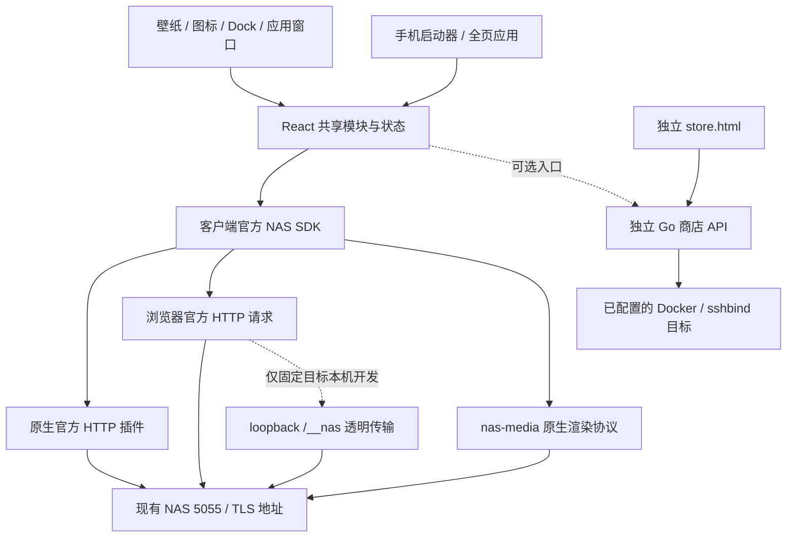

# 极空间完整客户端设计

日期：2026-10-10（Asia/Shanghai）
定位：面向极空间现有服务的第三方 NAS 系统桌面，暂用名称“空间桌面”，不宣称厂商官方发布身份。
状态：PC 使用 Tauri 2 + React/TypeScript，NAS 业务由客户端直连官方接口；Go 只承担独立第三方商店。手机先交付响应式 H5，原生手机后置。源码、构建、公钥探测与真实业务验收分别记录，不能据此宣称完整客户端已经交付。

## 1. 已确认的范围

用户确认保留 NAS 5055 与自带网页，新客户端重新设计文件、相册、影视、音乐、下载、应用和系统设置。外层必须是系统桌面：壁纸、应用图标、状态栏、Dock 和独立应用窗口；撤回整体常驻侧栏框架，侧栏只用于子应用内部。

PC 明确使用 Tauri，不使用 Flutter。手机当前仅为 H5；iOS、Android APK、HarmonyOS HAP 后续另行评估。GitHub 仓库、Actions、多平台产物与公开发布必须等待用户验收后的确认；本轮执行本地构建、NAS 独立商店部署与逐项验收。

商店是独立产品：无需 NAS 账号或桌面客户端即可使用其 Web 页面。客户端中保留可选商店入口；路线 A 的官方桌面/远程接续目标继续保留，但不把官方自动注册视为已经实现。

## 2. 当前架构与部署边界

NAS 正常登录、文件/媒体/系统读取由客户端 `OfficialNas` SDK 调用原官方路径。不存在运行中的自建 NAS REST API；Go 服务不注册 `/api/nas/*`，这些路径返回 404。历史 `server/internal/nas` 仅保留为退役协议测试参考，不能作为当前运行链路或后续实现依据。

| 部分 | 当前实现 | 依赖与限制 |
| --- | --- | --- |
| PC NAS 客户端 | Tauri 2 + React/TypeScript + 官方 HTTP 插件 | NAS 功能不需要 Go 服务，正常登录使用客户端自己的身份与会话 |
| 原生媒体 | 进程内 `nas-media` 渲染协议 | DOM 使用不透明引用；不监听 HTTP 端口、不提供 NAS REST |
| 浏览器/手机客户端 | React 响应式 H5 | 默认直接访问官方 NAS；受浏览器 CORS/Cookie 规则约束 |
| 本机 H5 开发传输 | loopback Vite 的固定目标 `/__nas/` | 仅开发、目标必须匹配，不对 LAN 开放；不替代生产部署 |
| 独立应用商店 | Go + SQLite + React `store.html` | 独立管理员、服务地址与执行目标，无需 NAS 登录 |
| 后续原生手机 | 尚待选型与实现 | 不计作本轮已交付能力 |

Tauri 官方 HTTP 插件保持 TLS 校验、禁止自动重定向，仅使用本客户端正常登录获得的 Cookie，不读取官方 Mac 客户端缓存或 `document.cookie`。原生媒体由当前进程保存会话与资源引用，NAS 地址及凭据不进入 DOM URL；它是渲染器媒体传输，不是本机 HTTP 代理服务器。

H5 默认由浏览器直接访问官方 API。仅本机开发时，可指定 `NAS_DEV_TARGET` / `VITE_NAS_DEV_TARGET`；SDK 只在所选 NAS 原点与配置一致时使用 `/__nas/`。透明传输保留官方路径、参数和响应，以本客户端新 token 与设备身份作无状态 Cookie 桥接，不借用其他客户端 Cookie、不持久化 Set-Cookie。正式 H5 同源部署尚待安排和验收，不能从开发代理通过推导 LAN/公网部署可用。

独立商店的 Go 静态入口 `/` 默认加载 `store.html`，完整客户端保留 `index.html`。客户端可设置非敏感商店服务地址；未设置外部地址时，原生客户端只在访问商店时按需启动本机商店 sidecar。当前 NAS 登录地址不会自动成为商店执行目标。

## 3. 业务分层



客户端 SDK 负责官方协议、归一实体、私有会话、业务码和分页映射；界面层负责窗口、分页、权限、离线和播放状态；原生层负责 HTTP/媒体传输与系统钥匙串。Go 仅负责商店认证、配方、存储、任务与容器执行。

桌面应用注册表定义 appId、图标、窗口内容与能力要求。固定模块和真实已安装第三方应用分开；容器运行状态与客户端窗口标记分开。

局域网 5055、直接 TLS 和官方远程中转是不同连接方式。远程中转仍需自己的正常授权、设备与中转参数，不是替换 baseURL；本项目不借用官方客户端 13579 代理或缓存登录态。能力状态保持 unknown、supported、unsupported、forbidden，附静态、合成测试与实机证据等级。

## 4. 正常登录与凭据

设备地址由用户填写，拒绝 URL userinfo、query、fragment 或非 HTTP(S) 地址。自动发现仅在协议验证后开放，不猜测网络发现格式或扫描无关网络。

正常登录走官方 `/key/pub` → `/auth/login`：每次取得新公钥，使用成熟 RSA 库处理官方表单，以客户端自己的稳定设备身份认证。“测试连接”只取得并验证公钥，成功显示“可达、尚未登录”，不提交账号密码。HTTP 200 与业务成功分开判断，验证码/新设备验证不能绕过。

NAS Token 只保留在 SDK 私有会话内存，不写普通文件、localStorage、日志或商店数据库。PC 默认仅在本次登录内存中使用密码；主动选择“保持登录”后才存入系统钥匙串。默认恢复仅预填；用户另行选择自动登录，才在启动时执行新的正常登录。钥匙串保存/删除失败应警告，不把已成功的内存登录变为失败。H5 不持久化密码或 Token，仅允许保存非敏感设备身份和商店地址。

会话绑定 NAS、账号和客户端设备身份。过期保留业务码与 HTTP 状态并引导重新登录；晚到的旧请求不能清除新会话。没有续期证据时不把反复密码登录称为 refresh。退出清除本地 NAS 会话及原生媒体引用；商店授权独立，退出商店调用其服务端 logout 撤销会话。

读取结果不展示密码、Cookie、Token、私钥等秘密。原生 DOM 只见 `nas-media` 不透明媒体引用；H5 的官方媒体鉴权参数只在当前内存和必要传输中使用，不记录到普通历史或诊断日志。

## 5. 桌面与手机信息架构

### 系统桌面与窗口

主界面采用原创壁纸、图标网格、状态栏和 Dock，无外层常驻侧栏。概览作为可打开应用或后续小组件，不能取代桌面。当前图标拖动仅整理本机 UI，不移动 NAS 文件；图标分组、桌面文件夹与持久化布局仍属于后续目标。

一个原生主窗口承载 React 子窗口，支持拖动、缩放、置前、最小化、最大化、恢复、关闭与显示桌面。窗口不能完全离开可用区域，显示尺寸变化后必须可找回。当前按应用、设备与用户隔离窗口；单应用多实例和更完整的布局恢复需另验。

关闭、最小化窗口只改变 UI，不停止 NAS 服务、下载或商店安装，不删除文件。音乐和媒体状态由共享播放器维护，平台后台行为、最小化播放策略与持久化队列不能未经实机验证就承诺。Dock 的运行标记表示窗口状态，不表示容器健康。

CPU、内存和速率只有真实接口字段确认后才显示，否则使用“—”或待验证。提供键盘启动、搜索和窗口控制，缩放可用键盘；完整读屏、焦点恢复和无需拖拽的整理命令仍需专门验收。

### 手机启动器

手机首页为 Launcher，进入应用后全页显示并提供返回桌面；不显示浮动窗、缩放边框或 Mac 窗口按钮。安装向导为手机全页表单，操作目标至少 44px。媒体与任务入口保持共享状态。

安全区、系统返回、手机文件提供者、通知与后台行为按平台验收；iPhone/Android/HarmonyOS 的设计图标签不代表已经存在原生安装包。

## 6. 最终功能目标与当前实现

下表是最终目标，不是已完成清单。现有源码已提供桌面/H5 外壳、主要模块读取与真实分页、播放器队列、商店向导及任务回读。真实媒体、写操作与高级功能仍按官方协议及实机结果逐项确认，未提供或禁用的动作不能算通过。

| 模块 | 最终目标 | 核心验收边界 |
| --- | --- | --- |
| 桌面 | 图标、分组、状态栏、Dock、窗口与概览 | 窗口可恢复，设备与账号不串数据，布局不移动文件 |
| 文件 | 个人/共享目录、搜索排序、详情、预览、下载、上传到新目录、新建目录 | 中文/大目录、权限、真实分页、完整性；上传和新建当前不冒充已完成 |
| 相册 | 时间线、相簿、筛选、原图、元数据与缩放 | 真实缩略图/原图、分页、无权限隔离、手机手势 |
| 影视 | 媒体库、详情/剧集、播放、音轨、字幕、清晰度、继续观看 | 地址取得、实际直放、转码、切轨、进度保存分别验证 |
| 音乐 | 曲库、专辑、歌单、收藏、歌词、播放模式和队列 | 音频鉴权、暂停/跳转、队列、歌词及平台媒体控制 |
| 下载 | 列表、筛选、新任务、真实进度、暂停/继续 | 当前已核实 loading/complete 读取；创建与控制动作另验 |
| 应用/商店 | 官方应用读取、第三方目录、安装、初始化与入口 | 安装、健康、首次配置、官方入口分别记录 |
| 任务 | 安装与文件传输等任务聚合 | 后台任务持续性与类型区分，不以关闭窗口取消任务 |
| 系统 | 设备、存储、网络、账号权限、通知和服务设置 | 当前读取与写入分开；保存须读回，不含破坏性动作 |

### 文件与列表

文件 ID、路径、所属空间与目录标记来自官方接口，不能以显示名作身份。上一页/下一页触发真实读取，不在第一批结果上切片。SDK 按官方规则映射文件/最近访问 start/num、影视 start/limit、相册/音乐 page/page_size、下载 start/size；根目录与影视分类发现不发送未支持参数。

切换目录、筛选、媒体库或账号重置页码，旧响应丢弃。本页名称筛选明确标注作用域，不能冒充全库搜索。上传与本地保存等后续功能必须遵守用户选定范围、路径及符号链接核验，冲突保留新副本，不覆盖既有内容。

### 媒体

内容发现、封面可读、媒体地址取得、直放、转码、字幕是不同状态。播放器属于新客户端，封面列表或跳转网页不能算完成播放。音乐队列与播放器跨应用存在，不等于后台与持久化已经通过。

只接受当前 NAS 原点及核实路径，拒绝任意外站、userinfo、重定向、旧会话媒体引用和未支持 HLS。原生使用 `nas-media`；本机 H5 开发仅对匹配目标使用透明传输。不得通过整段大视频 Blob 下载冒充流播放。真实 Range、格式、字幕、音轨、断网重连和进度保存按原生桌面与浏览器分别验收。

照片备份、AI 分类/人脸、影视刮削、CUE 和后台传输等高级能力仍需单独证据。缺失日期、封面或元数据不伪造。

### 系统设置

客户端本地偏好与 NAS 配置分开。NAS 写设置必须使用核实接口和权限，具备修改、保存、失败、禁用及读回状态；界面勾选或 HTTP 200 不等于保存成功。网络变更要展示确切新地址和重连方案。系统特权、整组配置覆盖或既有数据读写范围扩展须先讨论具体方案。

## 7. 数据保护

- 保留 NAS 5055、自带网页与已有资料；不重启或替换官方服务。
- 不提供删除、清空、格式化、删卷、容器数据清理、恢复出厂、prune 或 `down -v`。
- 不移动、重命名、批量改权限或重建既有资料；浏览与媒体优先只读。
- 新安装只写登记数据根下的新实例目录；媒体根独立且只读，停止实例保留数据。
- 不读取官方客户端缓存、系统密码文件或数据库来取得登录态；测试仅用合成凭据。
- 引导阶段只给新 `space-desktop` 专用目录设置 `0700`；后续独立商店发布、日志和元数据限制在已批准专用目录，不扩展到父目录或既有音乐库。

商店存储必须同时核验应用数据盘与 Docker 镜像盘，阻止系统盘/eMMC和未确认的镜像位置；媒体根可读不可写时仅授予 `mediaReadOnly`。虚拟数据池不能按名称宣称 SSD，`/tmp/zfsv3` 不可当普通临时目录清理。安装与既有媒体目录不得互相包含，卷身份在计划及执行时复验。

## 8. 视觉系统与素材

使用 Mac 风格的清晰层级、轻量材质、统一图标和系统字体；密集模块与表单优先可读性，支持减少动态效果。桌面内部侧栏只属于子应用，手机用全页导航。

全部原始设计资源与提示词保留在 [完整界面画廊](../../design-assets/zspace-client-gallery.md)。系统桌面、叠放窗口、登录和手机 Launcher 以 v2 方向为准；旧常驻侧栏图作为历史与子应用内容参考保留，不再代表主框架。

图中的照片、曲目、文件和进度均为设计示例，不是读取到的 NAS 数据。真实连接失败、未知能力、未授权与空数据分别显示，不自动用示例内容冒充成功。

## 9. 接口证据与验收状态

官方静态资源用于确定路径和参数，合成回归用于验证表单、RSA、分页、错误与安全边界；实际账户、文件和媒体必须重新在当前版本验收。

| 模块 | 当前官方路径举例 | 证据边界 |
| --- | --- | --- |
| 连接/登录 | `/key/pub`、`/auth/login` | 原生与固定目标 H5 开发代理公钥探测成功；旧 H5 曾由用户正常登录成功，最新传输待正常重新登录 |
| 文件 | `/system/polling2`、`/v2/file/list`、`/v2/recent/list` | 当前文件根按挂载 pools 生成；最近访问及详情已读取，分页与新根尚待复验 |
| 相册 | `/v2/album/home`、`/v2/album/album/feeds`、`/v2/album/feed/list` | 真实图片列表已读取，缩略图解码与图片预览尚待修复验收 |
| 影视 | `/zvideo/classification/list`、`/zvideo/video/v2/list`、`/zvideo/collection/info`、`/zvideo/collection/video`、`/transcode/play` | 真实分类已读取，集合/具体文件新流程经源码回归；实际播放、转码、字幕待验收 |
| 音乐 | `/zmusic/api/v2/song/list`、`/zmusic/api/v2/playlist/record/list`、`/transcode/audio/play` | 专辑/歌单/分页与播放地址回归；实际音频、歌词待验收 |
| 下载 | `/downloader/list` | loading/complete 与分页映射；真实任务状态须读回 |
| 设置/应用 | `/system`、`/setting/load`、`/network-settings/v1/interface/list`、`/AppStore/v1/list` | 读取入口与协议回归；实际字段、权限和写入逐项确认 |

本机 arm64 `.app` 已构建，Mac/H5 正常登录及部分受保护读取已确认；真实媒体和安装仍需独立验收。最新测试计数、版本与运行结果见 [续接验收记录](../../verification/2026-10-11-pc-store-h5.md)。

早期公开 SDK 研究见 [5055 调研](../../research/2026-10-10-client-5055-and-build.md)；可参考 [MIT 社区实现](https://github.com/coracoo/zspace_skill/tree/70879056149548c02f5cf66e2feb0a5bb69d235e)，但不能直接移植旧公钥、固定版本或缓存登录态。

## 10. 当前源码职责

```text
apps/client/src/
  api/                    官方 NAS SDK、独立商店客户端、会话与凭据
  desktop/                图标、窗口状态、焦点与恢复
  modules/                文件、媒体、下载、商店、设置与分页
  App.tsx/styles.css      桌面、手机 Launcher 与登录
  StandaloneStore.tsx      独立 Web 商店，无需 NAS 登录
apps/client/dev/          仅 loopback 的固定目标官方透明传输
apps/client/public/       原创 SVG 壁纸
apps/client/src-tauri/    官方 HTTP、nas-media、钥匙串、可选商店 sidecar
server/cmd/space-gateway/ 独立商店 HTTP 与静态入口，/ 默认 store.html
server/internal/store/    商店配方、存储、任务与 Docker/sshbind
server/internal/nas/      退役协议测试参考，不注册运行 API
scripts/                  本地构建与商店启动/部署
```

历史名 `space-gateway` / `gateway.json` 不改变当前职责。GitHub workflow 只在用户确认后创建。

## 11. 后续验收顺序

当前顺序：官方 SDK 和原生传输 → 用户在当前版本正常登录 → 受保护文件与媒体逐项验收 → 独立商店部署、存储计划、安装、健康与首次配置 → 正式 H5 同源部署。原生手机与 GitHub 多端构建后置。

桌面需要多窗口拖动/缩放/恢复、设备账号隔离、低分辨率找回、键盘与读屏验收；手机验证 Launcher → 全页应用 → 返回，以及共享媒体/任务状态。每个模块要同时具备新 UI、真实接口、离线/权限/失败状态和人工证据，不能用构建或示例截图代替。

官方远程单独验收：不依赖官方电脑客户端或 13579，在真实外网完成正常授权、设备选择、读取、过期与重连。局域网验证不等于官方远程可用。

独立商店服务已在 NAS 的 18435 端口启动，用户正在通过本地连接或 SSH 转发初始化管理员；示范应用安装、健康与首次配置尚不能记为完成。服务可访问、脚本准备和目录登记不能替代应用验收证据。部署进度见 [独立商店部署说明](../../deployment/standalone-store.md)，本地构建安排见 [交付计划](../plans/2026-10-10-zspace-client-build-and-release.md)，实际验收以 [验收记录](../../verification/2026-10-10-pc-store-h5.md) 为准。
